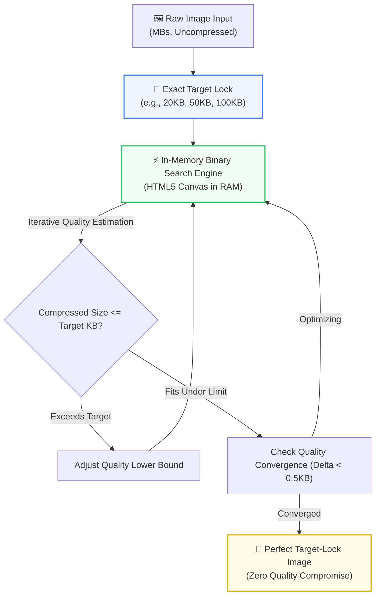

# PdfAndImg

<div align="center">

> **The Ultimate 100% Client-Side Multi-Tool Utility Suite**  
> Precision target-lock image compression, in-browser PDF manipulation, Apple HEIC conversion, and exact-dimension passport photo tools.

[](https://pdfandimg.com)
[](https://pdfandimg.com)
[](https://pdfandimg.com)
[](https://pdfandimg.com)

<br/>

👉 **Launch Web Suite:** [**https://pdfandimg.com**](https://pdfandimg.com)

</div>

---

## ⚡ Architecture: The Target-Lock Binary Search Engine

Instead of guessing with arbitrary 0-100% "quality" sliders that require endless trial-and-error, **PdfAndImg** uses a mathematical binary search algorithm executed locally in Canvas RAM. It iteratively converges on the exact target file size (e.g., 20KB, 50KB, 100KB) while retaining maximum visual clarity:



---

## 🥊 Feature Comparison: Why PdfAndImg Wins

| Feature | Generic Image Compressors | Legacy Online PDF Portals | PdfAndImg.com |
| :--- | :---: | :---: | :---: |
| **Exact Target Sizing** | ❌ Arbitrary quality % slider | ❌ High/Medium/Low preset only | **✅ Precision Target Lock (e.g., exactly 20KB, 50KB)** |
| **Zero-Server Privacy** | ❌ Uploads files to cloud servers | ❌ Uploads documents to server | **✅ 100% In-Browser (Zero Uploads)** |
| **Apple HEIC Support** | ❌ Unsupported or paid upgrade | ❌ Limited format support | **✅ In-browser HEIC to JPG/PNG/PDF** |
| **Massive PDF Reorganization** | Laggy / Paywalled | Paywalled after 3 files | **✅ Custom Sticky Stash drag-and-drop** |
| **File Caps & Throttles** | ⚠️ 5MB-10MB free limit | ⚠️ 15MB file cap | **✅ Unlimited client-side processing** |
| **Cost** | Freemium traps | Monthly Subscription | **✅ 100% Free Forever** |

---

## 🚀 Specialized Tool Suites (60+ Micro-Tools)

### 1. Target-Lock Image Compression Suite
- **/compress-image-to-20kb:** Calibrated for strict government job portals, exams, and visa signatures.
- **/compress-image-to-50kb & /compress-image-to-100kb:** Optimal for corporate forms, bank KYC, and passport uploads.
- **KB Enhancer:** Upsize low-resolution images to satisfy strict minimum byte thresholds via intelligent lossless padding.

### 2. In-Browser PDF Studio
- **Organize & Remove PDF Pages:** Advanced visual page manager with a **Sticky Stash** sidebar, allowing effortless page reorganization across 200+ page documents using `SortableJS`.
- **Merge & Split PDF:** Zero-server document assembly and extraction via `pdf-lib`.
- **Images to PDF:** Batch convert photos and scans into uniform multi-page PDF documents.

### 3. Apple HEIC Conversion Engine
- Decode Apple's proprietary `.heic` and `.heif` photos locally into universally viewable `.jpg`, `.png`, or `.pdf` formats via `heic2any` without server upload latency.

### 4. Official Dimension Cropper & Form Resizer
- Exact centimeter and pixel cropping for passport photos, academic exams, driver licenses, and job portal signature boxes.

---

## 📁 Architecture Overview

```text
┌────────────────────────────────────────────────────────────────────────┐
│                        SUITE ARCHITECTURE                              │
├────────────────────────────┬───────────────────────────────────────────┤
│ Core Engine                │ Astro.js Static Multi-Page Architecture   │
│ Client-Side Processing     │ HTML5 Canvas API, pdf-lib, heic2any       │
│ UI & Interaction           │ Vanilla CSS + SortableJS Drag-and-Drop    │
│ Security Boundary          │ 100% Local RAM Execution (Zero Backend)   │
│ CDN & Edge Hosting         │ Cloudflare Pages ($0 Server Cost Forever) │
└────────────────────────────┴───────────────────────────────────────────┘
```

---

## 🔒 Privacy & Security Guarantee

1. **Zero Server Uploads:** All image compression, resizing, format conversion, and PDF packaging happen **100% locally** in the user's browser.
2. **Zero File Retention:** User photos, identity documents, and sensitive attachments never touch any backend server, database, or cloud cache.
3. **Session Ephemeral:** Memory is immediately garbage-collected upon closing or refreshing the browser tab.

---

## 📄 License

© [PdfAndImg.com](https://pdfandimg.com) — All Rights Reserved.
